<p align="center"></p>

<h1 align="center">Lion AI Models</h1>
<p align="center"><b>Professional Model Suite</b><br>
Keep every AI model you own on a NAS. Play any of them on your GPU box with one click, without ever knocking out the model you are using.</p>

<p align="center"><em>The NAS Model Cassette Changer, redesigned. Created by <a href="https://github.com/sunnychase">Sunny Chase</a> in collaboration with Claude (Anthropic).</em></p>

<p align="center">
  <a href="https://github.com/sunnychase/nas-model-cassette-changer/actions/workflows/tests.yml"></a>
  <a href="https://github.com/sunnychase/nas-model-cassette-changer/releases"></a>
  <a href="LICENSE"></a>
  <a href="#prerequisites"></a>
  <a href="#prerequisites"></a>
  <a href="#engines"></a>
  <a href="#hardware-required"></a>
  <a href="https://github.com/sunnychase/nas-model-cassette-changer/commits/main"></a>
  <a href="https://github.com/sunnychase/nas-model-cassette-changer"></a>
  <a href="https://donate.stripe.com/fZuaER2Cbecw7cQ6PlfEk00"></a>
</p>

<p align="center">
  <a href="https://x.com/LionFMN"></a>
</p>

<p align="center">
  <a href="#quick-start">Quick start</a> ·
  <a href="#how-it-works">How it works</a> ·
  <a href="#engines">Engines</a> ·
  <a href="#whats-new-in-15-long-context-benchmarks-a-quality-test-history-and-phone-alerts">What's new</a> ·
  <a href="#benchmarks">Benchmarks</a> ·
  <a href="#screenshots">Screenshots</a> ·
  <a href="#faq">FAQ</a> ·
  <a href="#documentation">Documentation</a> ·
  <a href="#contributing">Contributing</a>
</p>

<p align="center"><a href="docs/media/lion-ai-models-reel.mp4"></a><br>
<sub>▶ <a href="docs/media/lion-ai-models-reel.mp4"><b>Watch the one-minute reel</b></a> (MP4, 1920 × 1080, silent): every function of 1.5 in demo mode:
sign in, the shelf and the engine selector, the guard, a TensorFold recipe loading and playing, the long-context decode at 1, 2, 4 and 8
streams, the prefill sweep, the quality test, history, phone alerts and the phone layout. Every frame is the deck page itself, in demo
mode: the figures in it are simulated (the measured ones are in [Benchmarks](#benchmarks)).</sub></p>

Local models are huge. A GPU box has a fast but small disk; a NAS has lots of cheap space but is far too slow to serve from. The NAS Model Cassette Changer treats every model like a cassette on a shelf:

- **The shelf (NAS)**: a small indexer catalogues every model folder: maker, model, variant, format, quantisation and size. It also works out how many GPU nodes each one needs.
- **The deck (GPU box)**: a web page lists the whole shelf. Press **INSERT** and it copies the model to local NVMe and starts it: in **Ollama** (GGUF), in a **vLLM** or **SGLang** container (safetensors, your choice per model), or with the model's own **recipe lane** (for example a **TensorFold** serving recipe).
- **The guard**: an insert never stops anything you didn't name. If loading a model would evict something, the deck lists exactly what would stop and waits until you tick every name. Models you mark as *protected* keep their memory reserved even when they are unloaded.
- **The ejector**: stops the cassette and, if you ask, deletes the local copy. The NAS copy is never touched.
- **The bench** (new in 1.5): measures what is playing the way you use it: every stream first filled to a long context, then 1, 2, 4 and 8
  streams decoding together; a prefill sweep from 1k to 256k tokens; and a fixed 60-question quality test, graded by rule.
- **The watch** (new in 1.5): two days of minute-by-minute history and thirty days at a glance (temperature, GPU, memory, power, tokens per
  second), and an alert on your phone, through the free ntfy app, when the box needs you.

## Quick start

### Download

```bash
git clone https://github.com/sunnychase/nas-model-cassette-changer.git
cd nas-model-cassette-changer
```

Or download the ZIP: **Code → Download ZIP** on the GitHub page, or grab a tagged release from the **Releases** tab.

### Try it in 10 seconds (no NAS, no GPU)

```bash
python3 deck/mcc_deck.py serve --demo
# open http://127.0.0.1:8099/
```

Demo mode fakes a 35-model NAS and a 128 GB GPU box. Insert, eject, the guard dialog and the log all work; nothing on your machine is touched. Add `--demo-no-ollama` to simulate a box with Ollama stopped, so you can play the TensorFold recipe row.

### On real hardware

**On the NAS** (any Linux box holding your model folders):

```bash
sudo scripts/install-nas.sh                 # installs mcc_index.py + a 10-minute systemd timer
sudoedit /etc/mcc/nas.json                   # where your model folders are
python3 /usr/local/bin/mcc_index.py --dry-run
sudo systemctl enable --now mcc-index.timer
```

**On the GPU box:**

```bash
scripts/install-deck.sh                      # per-user install, no root
$EDITOR ~/.config/mcc/deck.json              # ssh alias of the NAS, its library path, protected models
python3 ~/.local/share/mcc/mcc_deck.py sync  # first copy of the index
systemctl --user enable --now mcc-sync.timer mcc-deck.service
```

Open `http://127.0.0.1:8099/` and paste the token from `~/.config/mcc/token`.

The full walkthrough is in the **[User Guide](docs/USER_GUIDE.md)**. It covers folder layouts, every config key, the guard rules, remote access, troubleshooting and the API.

### Hardware required

| | Minimum | Developed and tested on |
|---|---|---|
| **GPU box** | Linux with an NVIDIA GPU (or Apple silicon for recipe lanes), enough fast local disk to hold the models you play | **NVIDIA DGX Spark** (GB10, 128 GB unified memory, aarch64, 4 TB NVMe) |
| **NAS** | Any always-on Linux machine with enough storage for your model library | Ubuntu Server 24.04 on a 4-bay NAS, one 20 TB drive (19 TB XFS) |
| **Network** | Gigabit Ethernet (about 110 MB/s, so a 60 GB model takes ~10 min) | **10 GbE** between the NAS and the GPU box (see [Use 10 GbE](#use-10-gbe-between-the-nas-and-the-gpu-box)) |
| **Optional** | A NAS network card with Wake-on-LAN, if you let the NAS sleep | |

- The node-count estimate defaults to **128 GB unified-memory nodes** (a DGX Spark). For other cards, change the per-node budget and overheads
  in `deck.json` (see [How the node count is estimated](#how-the-node-count-is-estimated)).
- Local disk: a GGUF cassette needs about **2.2 × its size** while it is created (Ollama writes a copy); safetensors about **1.1 ×**.
- Several GPU nodes (up to four) are shown in the GPU-nodes panel. The deck only *inserts* single-node models; bigger ones keep their tier.

### Prerequisites

**GPU box**
- Linux, **Python 3.9+** (standard library only: nothing to `pip install`), `ssh`, `rsync`, systemd user services.
- Key-based **ssh** access to the NAS (an alias in `~/.ssh/config`).
- At least one engine:
  - [Ollama](https://ollama.com) for GGUF models;
  - **Docker + NVIDIA Container Toolkit** for the vLLM / SGLang images (safetensors);
  - optional **recipe lanes** such as a TensorFold serving recipe (from its own repository, under its own licence).
- A browser on your network. The deck listens on `127.0.0.1:8099` with a token; put a reverse proxy with authentication in front if you
  reach it from elsewhere (see [SECURITY.md](SECURITY.md)).

**NAS**
- Linux, **Python 3.9+**, an **ssh** server, and `rsync`.
- Your model folders on local disk. The indexer only *reads* them and publishes a symlink library plus `library.json`.
- systemd, for the 10-minute index timer.

**Accounts and keys:** none. Download models however you like (for example `huggingface-cli`). The deck never contacts a model hub.

## How it works

```
 browser (desktop or phone)
        │  http://127.0.0.1:8099 + token
        ▼
 the deck ── deck/mcc_deck.py on the GPU box: one Python file, standard library only; the page, the guard, INSERT and EJECT
        │
        ├── sync, every 10 min ... ssh (BatchMode): copies library.json and the .gguf list; never wakes a sleeping NAS
        ├── INSERT ............... rsync --partial from the NAS to local NVMe (~/models/deck), then starts the engine
        ├── engines .............. Ollama (GGUF) · a vLLM or SGLang container (safetensors) · recipe lanes (e.g. TensorFold)
        └── bench + watch ........ deck/mcc_bench.py: long-context runs, the quality test, history, health, ntfy alerts (v1.5)

 the NAS ── nas/mcc_index.py, every 10 min: catalogues the model folders, builds the library/ symlinks, tiers and kits,
            and writes library.json; the deck only ever reads from it
```

Before an INSERT touches anything, the guard plans it: is the unit servable, does it fit on one node, does it fit in memory
beside what is running (protected models keep their reserve), and, for a safetensors model, can the engine image load its
architecture. If the plan would stop or evict anything, the deck names every one and waits until you confirm each name. The
plan is checked again after the copy, and if a GGUF load pushes out a protected model anyway, the new cassette is unloaded.
One GPU engine plays at a time. Everything machine-specific (the NAS's ssh alias and library path, protected models, ports,
the fit constants) lives in `~/.config/mcc/deck.json` on the GPU box and `/etc/mcc/nas.json` on the NAS.

It is three plain Python files and one page with **no dependencies** beyond the standard library, plus `ssh`, `rsync`, Ollama and/or Docker on
the GPU box.

### How it fits together

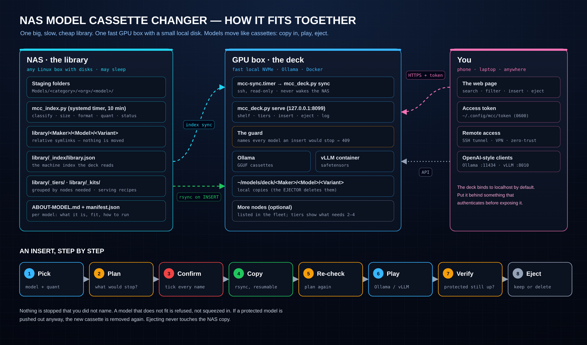

### How the node count is estimated

Each runnable unit (one GGUF quant, or one whole safetensors folder) gets the smallest node count *k* for which the weights plus per-node overhead fit:

`max(W + 5.6·k + 8, 1.15·W) ≤ 95.69·k`  (GiB, W = weights; defaults are tuned for a 128 GB unified-memory node)

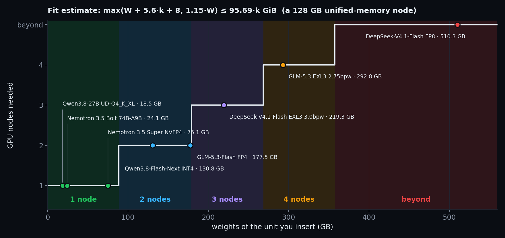

The dots are recent models at the sizes of real units in a working library (October 2026): Qwen3.8-27B (UD-Q4_K_XL GGUF, 18.5 GB),
Nemotron 3.5 Bolt 74B-A9B (24.1 GB), Nemotron 3.5 Super VL 120B-A12B NVFP4 (75.1 GB), Qwen3.8-Flash-Next 125B-A5B INT4 (130.8 GB),
GLM-5.3-Flash FP4 (177.5 GB), DeepSeek-V4.1-Flash EXL3 3.0 bpw (219.3 GB), GLM-5.3 EXL3 2.75 bpw (292.8 GB) and DeepSeek-V4.1-Flash
FP8 (510.3 GB). A recipe lane states its own memory need, so it can play a unit on fewer nodes than this estimate: the
Qwen3.8-Flash-Next INT4 cassette in the clip above plays on one node in its TensorFold lane.

This is an estimate and a *floor*. Every constant is in the config, so you can tune it for your own cards. The deck itself only inserts single-node units; anything bigger is shown with its tier and any matching multi-node "kit" (a serving recipe kept on the NAS).

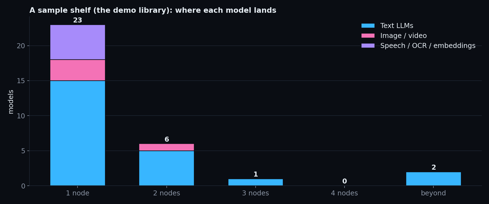

## Engines

| Model on the NAS | Played by | How |
|---|---|---|
| GGUF (any quant, split shards, vision projector) | **Ollama** | `ollama create deck/<name>` + warm load at a fixed context |
| safetensors | **vLLM** | `vllm/vllm-openai` container on :8010 |
| safetensors | **SGLang** | `lmsysorg/sglang` container on :30000 |
| anything listed in `recipes.json` | **its recipe lane**, e.g. **TensorFold** | the recipe's own `start.sh` / `stop.sh`, health-checked |
| EXL3 / EXL2 | *listed under EXL3, not played yet* | needs an exllamav3 / TabbyAPI player; the selector shows them so you know they are there |

One GPU engine at a time: a vLLM, SGLang or recipe cassette must be ejected before another one is inserted. Recipe lanes such as TensorFold state their own memory need, and the deck checks it before stopping anything. If the recipe needs Ollama stopped, the deck says so and waits for you; it never stops a system service itself. See the [User Guide §7](docs/USER_GUIDE.md#7-engines-and-recipe-lanes-sglang-tensorfold).

## Use 10 GbE between the NAS and the GPU box

Every INSERT is a full copy of the model, so the link sets how long you wait:

| Link | Real-world copy rate | 20 GB GGUF | 65 GB safetensors | 113 GB model |
|---|---|---|---|---|
| 1 GbE | ~110 MB/s | ~3 min | ~10 min | ~17 min |
| 2.5 GbE | ~280 MB/s | ~1.2 min | ~4 min | ~7 min |
| **10 GbE** | **~800–1100 MB/s** | **~20–25 s** | **~1–1.5 min** | **~2 min** |

**A 10 GbE link (NICs on both boxes and a 10 GbE switch or a direct cable) is strongly recommended.** It only pays off if the NAS disks can keep up: one hard drive tops out around 150–250 MB/s. Use several drives, an SSD/NVMe pool or a read cache on the NAS. Ejecting is instant either way (it stops the model and, if you ask, deletes the local copy), and with a fast link re-inserting a model you deleted takes about a minute.

## What's new in 1.5: long-context benchmarks, a quality test, history and phone alerts

- **Long context · streams:** each stream is first filled to a start context (16k up to 256k, or your own number), then 1, 2, 4 and 8
  streams decode together. You see the speed a long chat really gets, per stream and in total, the time to the first token, and whether the
  engine reused the context or read it again ([§14.1](docs/USER_GUIDE.md#141-long-context--streams)).
- **Prefill sweep:** time to the first token from 1k to 256k tokens, a fresh prompt every time.
- **Quality test:** 60 fixed questions in six kinds at temperature 0, graded by rule, the last 30 runs kept, and an exact test that says
  whether a change between two runs is real or could be chance.
- **Every run gives way:** it plans its memory before it starts, refuses while someone is using the engine and stops when someone starts,
  stops if memory runs low, and can be cancelled at any time. It never loads a model, and Ollama is measured at its own context so it never
  reloads.
- **History:** temperature, GPU and CPU use, memory, power, decode and prefill, minute by minute for 48 hours and every 15 minutes for 30 days.
- **Health and phone alerts:** memory low, a hot GPU, a GPU error or an out-of-memory kill in the kernel log, an engine that stopped by itself,
  a nearly full disk; sent to your phone through ntfy once you create a topic. Off by default.
- **A sign-in card** with the lion instead of a browser prompt; the token is checked before it is kept. The lion is in the header too.
- `deck/mcc_bench.py` (standard library only), 31 new tests against stub engines (82 in all), demo mode covers all of it.

## What's new in 1.4: Lion AI Models

- **A new, professional interface:** a sidebar with sections (Now playing · Engines · GPU nodes · Models · Local copies · Deck log) that
  highlight as you scroll, a clean header, a charcoal-and-gold palette, calmer cards and tables, and gold primary actions.
- **Better on a phone:** the sidebar becomes a scrolling top bar, and every model row turns into a stacked card with a full-width PLAY button.
- **Same engine underneath:** every control, id and API is unchanged; the page is still one self-contained file with no build step and no
  external assets.

## The cassette selector (v1.3)

- **ENGINE bar:** All · Ollama · vLLM · SGLang · every recipe lane (e.g. TensorFold) · EXL3 · Apps, each with its model count and a status dot
  (green = playing now, red = Ollama stopped, grey = idle, hollow = listed but not playable from the deck). Pick one and the whole shelf shows only
  what that engine plays. Links work too: `http://deck:8099/#engine=vLLM`.
- **The player:** a cassette that shows what is loaded, what else is resident, and memory free. The reels turn while a cassette **plays** and
  faster while it **loads**; the frame is **green** when playing, **amber** while loading and **red** when the deck is stopped or empty
  (with *reduce motion* set in the system, the reels hold still). A failed load stays on the player (*⚠ last load failed: … — why*) until you
  dismiss it or a load succeeds.
- **Architecture check:** before anything is copied or stopped, a safetensors model's `config.json` architectures are checked against the list
  its engine image can actually load (`mcc_deck.py archs vllm`). A model the image can't run is refused up front instead of after a long copy.
- **NAS dot** in the header: green = awake at the last sync, red = asleep (the last index is shown).

### Benchmarks

#### Beside the tape

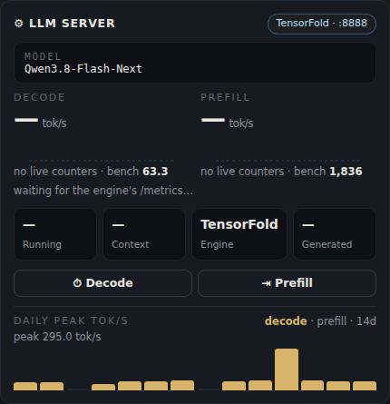

To the right of the cassette, the **LLM server** card measures whatever is loaded:

- **Decode / Prefill tok/s, live**, read every 5 s from the engine's own Prometheus counters (`/metrics` on vLLM, SGLang, or a recipe lane
  with `metrics_path`), with a 30-minute sparkline, the average while busy, and *Serving · n running* or *Idle · last served 2m ago*.
- **Running requests, context, engine, tokens generated** since the engine started.
- **⏱ Decode** (256 tokens out, timed after the first token) and **⇥ Prefill** (≈ 2,000 tokens in, time to first token) benchmark buttons.
  They work on Ollama too, using Ollama's own timings. Every prompt starts with a random nonce, so prefix caches can't flatter the number.
- **Daily peak tok/s** for the last 14 days, decode or prefill.

Results are kept in `bench.jsonl` / `peaks.json` in the state dir.
<br clear="right">

#### Long context, prefill sweep and the quality test (1.5)

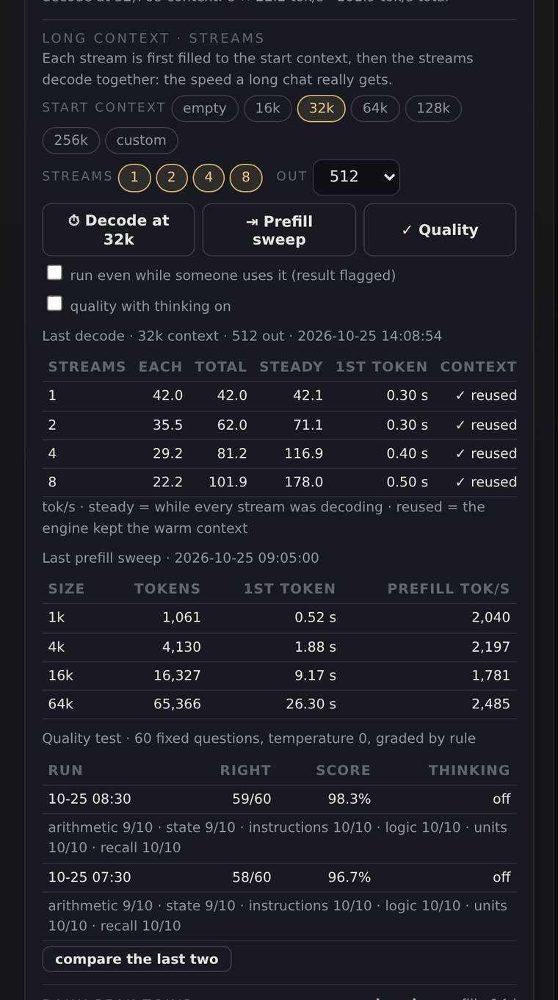

Below the quick buttons, **LONG CONTEXT · STREAMS**:

- **⏱ Decode at 32k** (or any start context): every stream is warmed with its own long context, then 1, 2, 4 and 8 streams decode at once.
  The table gives tokens per second **each** and in **total**, a **steady** rate while every stream was decoding, the **first-token** time,
  and **✓ reused** or **recomputed** for the context, from the engine's own cached-token count.
- **⇥ Prefill sweep:** 1k, 4k, 16k, 32k, 64k, 128k and 256k tokens, a fresh prompt each time: time to the first token and prefill tokens
  per second.
- **✓ Quality:** 60 fixed questions, graded by rule; **compare the last two** runs with an exact McNemar test.

*The screenshot is demo mode: its figures are simulated. The table below is measured.*

Every run first shows its plan (time, memory, the limits read from the engine) and waits for your OK. It never loads a model, gives way to
any other client, stops if memory runs low, and has a **Cancel** button. The numbers are the engine's own token counts and the client's
clock, never a guess; anything unusual (a context that was read again, an early end, another client, an engine error) is flagged on the row.

Measured on one DGX Spark, Qwen3.8-Flash-Next INT4 in a TensorFold recipe lane, 512 tokens out:

| start context | streams | each | total | first token | cold prefill |
|---|---|---|---|---|---|
| 16k | 1 | 40.3 tok/s | 40.3 tok/s | 0.3 s (context reused) | 9.2 s |
| 16k | 2 | 31.8 tok/s | 60.0 tok/s | 0.5 s (reused) | |
| 64k | 1 | 40.6 tok/s | 40.6 tok/s | 0.3 s (reused) | 26.3 s |
| 64k | 2 | 28.9 tok/s | 55.8 tok/s | 0.5 s (reused) | |

The memory each run needs is planned from the recipe's own figure with a margin set from these runs and two more at 128k (1.06× the formula at 16k, 1.29× at
64k, 0.99× and 0.93× at 128k with one and two streams). Everything is in [User Guide §14](docs/USER_GUIDE.md#14-benchmarks-history-and-phone-alerts-v15).
<br clear="right">

### History and phone alerts (1.5)

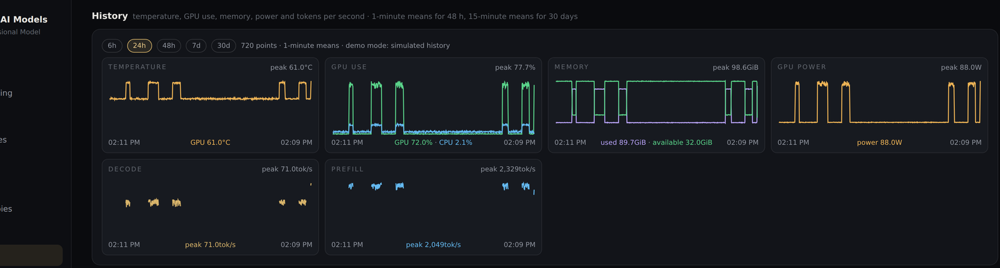
<sub>Demo mode: simulated history.</sub>

**History** charts temperature, GPU and CPU use, memory, GPU power and the decode and prefill peaks over 6 hours to 30 days: 1-minute means
for 48 hours and 15-minute means for 30 days, in two small files in the state dir.

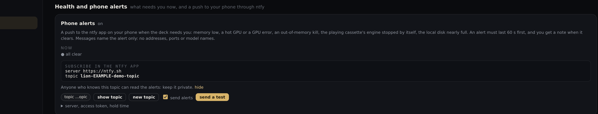

**Health and phone alerts** lists what needs you now, and sends it to your phone through [ntfy](https://ntfy.sh): create a topic, subscribe to
it in the ntfy app, tick *send alerts*. An alert must last a minute first, you get a note when it clears, and a message names the alert only
(no host, address, port, model or token). It is off until you set it up.

## Screenshots

<p align="center">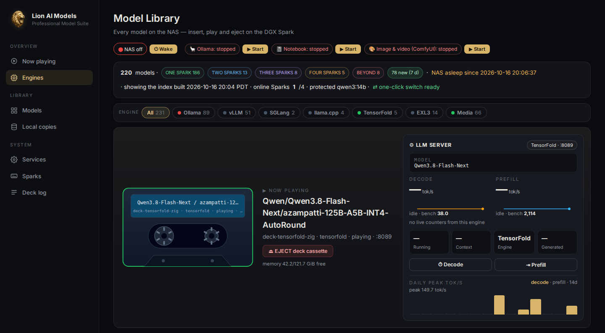<br>
<em>A working deck: 220 models on the NAS, Qwen3.8-Flash-Next playing in a TensorFold lane. This deck carries a few local extras
(service chips, a llama.cpp and a Media tab) on top of the public page; the views below are the public page in demo mode.</em></p>

| The shelf, grouped by how many nodes each model needs | The guard: nothing stops until you name it |
|---|---|
|  | 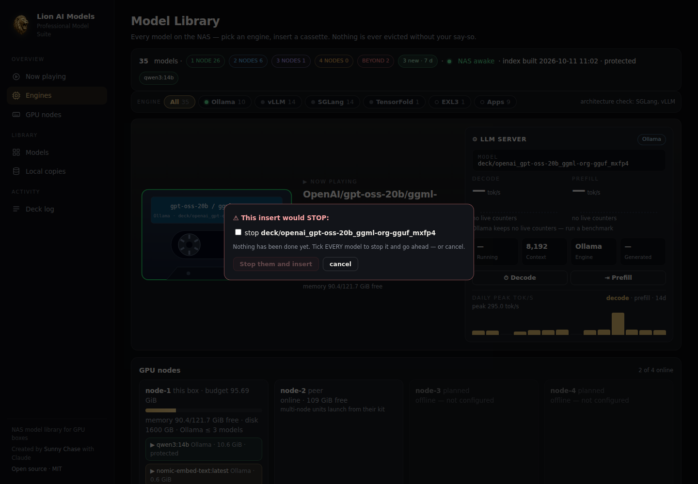 |
| **Loading:** a resumable rsync from the NAS, then start | **Ejector and deck log** |
| 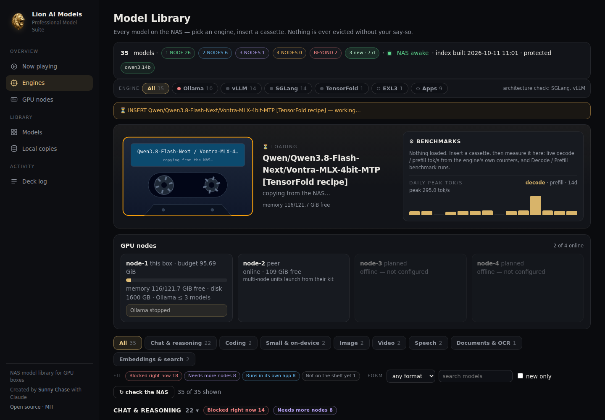 | 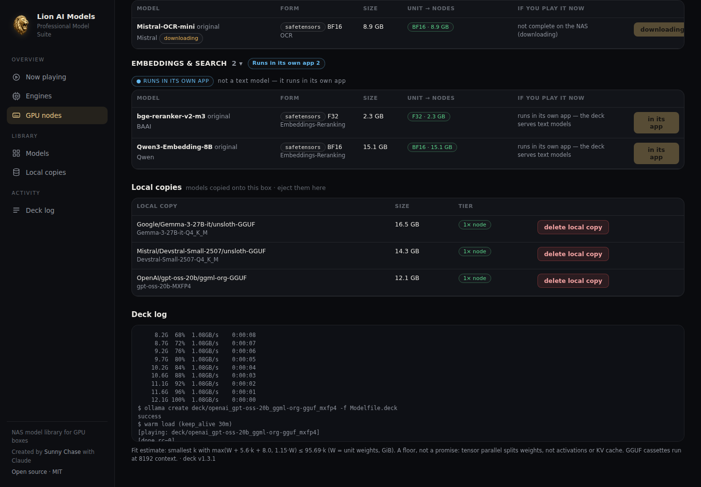 |
| **Engines:** vLLM or SGLang per model, plus a TensorFold recipe row | **A TensorFold recipe lane playing** (Ollama stopped) |
| 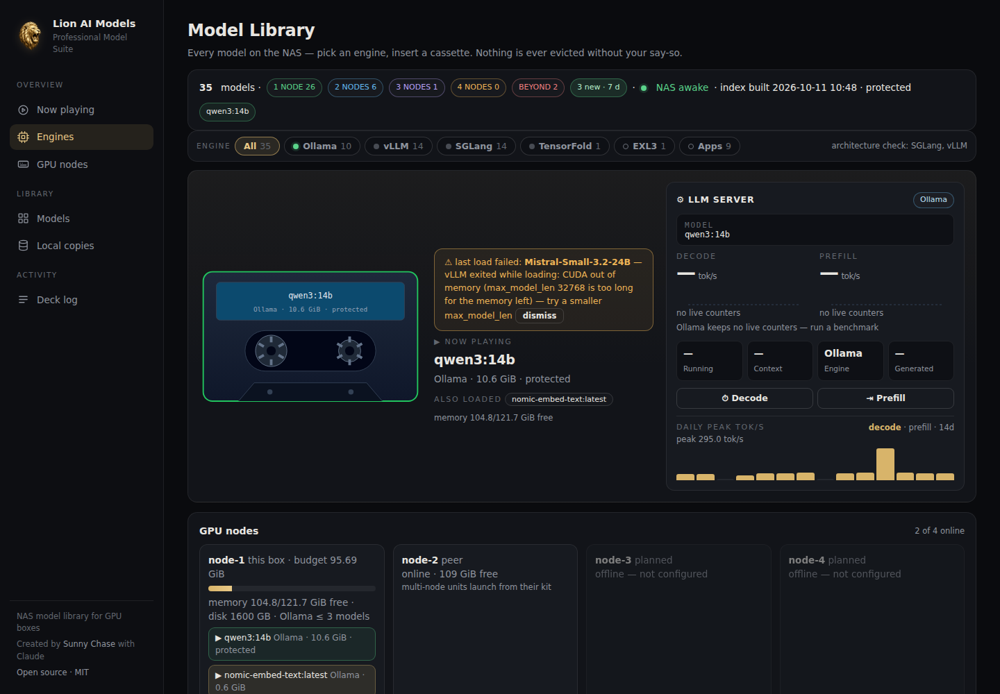 | 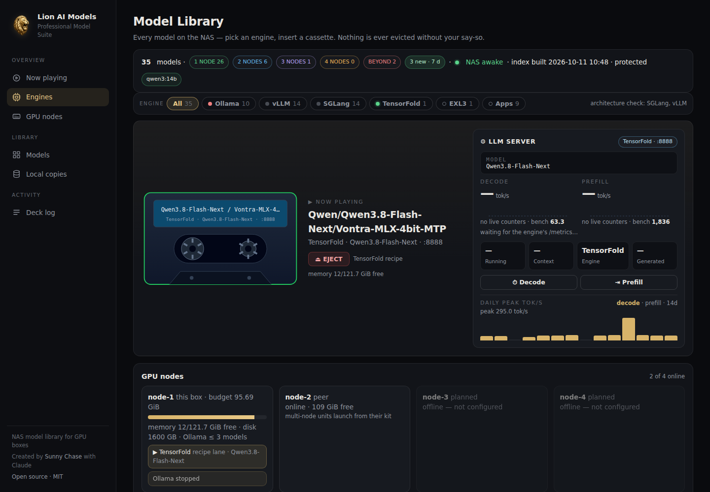 |
| **Selector on vLLM:** the architecture check refuses a model before the copy | **Loading:** amber frame, the reels turning fast |
| 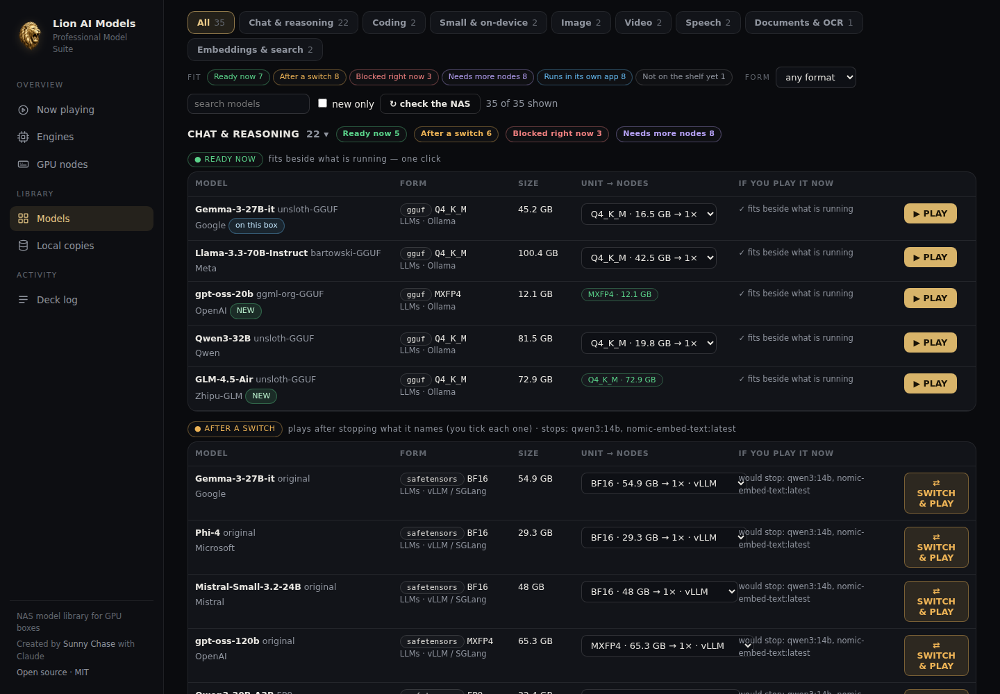 |  |

| **Sign in** (1.5): the lion, and the token checked before it is kept | **On a phone** (1.5): the player and the LLM server card (demo mode, simulated figures) |
|---|---|
| 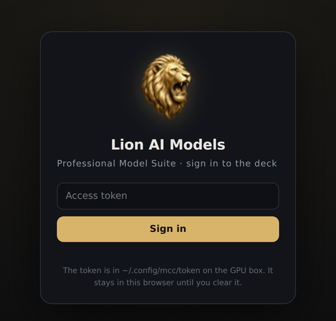 | 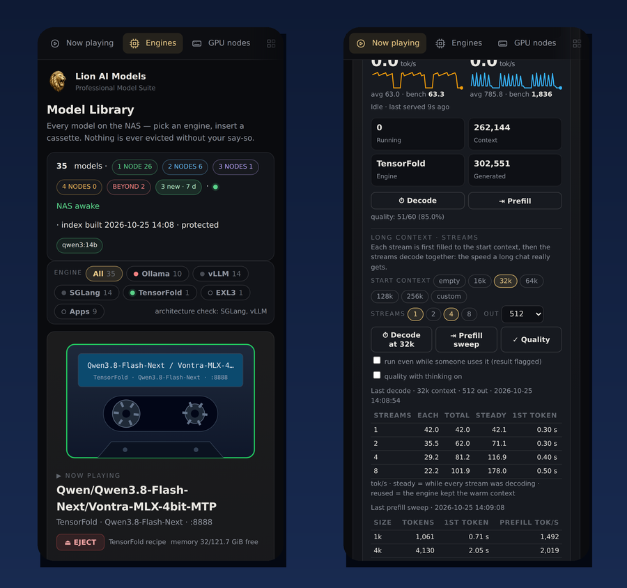 |

<p align="center">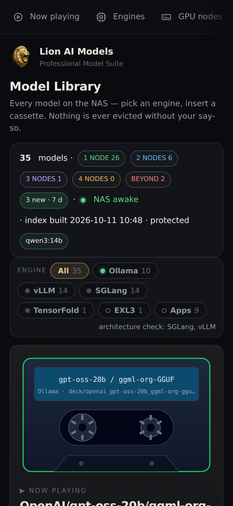<br><em>Works on a phone.</em></p>

## FAQ

<details>
<summary><b>Can I try it without a NAS or a GPU?</b></summary>

Yes. `python3 deck/mcc_deck.py serve --demo` fakes a 35-model NAS and a 128 GB GPU box. Insert, eject, the guard dialog and
the log all work, and nothing on your machine is touched. Add `--demo-no-ollama` to play the TensorFold recipe row. See
[Try it in 10 seconds](#try-it-in-10-seconds-no-nas-no-gpu).
</details>

<details>
<summary><b>Can an insert knock out the model I am using?</b></summary>

No. An insert never stops anything you did not name: if it would stop or evict anything, the server answers 409 with the
exact list and does nothing until every name is confirmed. Protected models keep their memory reserved even when they are
unloaded, and a GGUF insert never evicts them. A vLLM or SGLang cassette takes most of the GPU, so its dialog names
everything it would stop, protected models included. The plan is checked again after the copy. The rules are in
[User Guide §6](docs/USER_GUIDE.md#6-the-guard-rule-by-rule).
</details>

<details>
<summary><b>Will a benchmark get in the way of a chat?</b></summary>

No. A long-context run refuses to start while the engine is serving anyone else and stops as soon as another request arrives (unless you
tick *run even while someone uses it*, and then the result is flagged). It never loads a model, it stops if memory runs low, and Cancel
closes every request at once. Ollama is measured through its own API at the resident model's context, so it is never reloaded.
</details>

<details>
<summary><b>What does a phone alert send, and to whom?</b></summary>

Only the kind of alert, for example *memory low (under 8 GiB free)*, to the ntfy server and topic you set up (the public ntfy.sh or your
own). No host name, address, port, model name or token. Anyone who knows the topic can read it, so keep it private or reserve it. Alerts are
off until you create a topic, and the deck only ever sends over https to a public address.
</details>

<details>
<summary><b>Why not run models straight off the NAS share?</b></summary>

Loading a model reads every byte, often more than once, and network page-cache misses make it slow and fragile. Copy once to
NVMe, then run. Over 10 GbE a 65 GB model copies in about 1–1.5 minutes (see [Use 10 GbE](#use-10-gbe-between-the-nas-and-the-gpu-box)).
</details>

<details>
<summary><b>Does the sync wake my NAS?</b></summary>

No. It makes one ssh attempt with a 5-second timeout. If the NAS does not answer, it records *asleep* and keeps the last
index, and the header dot turns red.
</details>

<details>
<summary><b>Can I use it without Ollama, or without Docker?</b></summary>

Yes. GGUF needs only Ollama, vLLM and SGLang only Docker (with the NVIDIA Container Toolkit); whichever is missing just
refuses that path. An Ollama that is stopped or not installed does not block vLLM, SGLang or recipe inserts.
</details>

<details>
<summary><b>Why only one GPU engine at a time?</b></summary>

On a single GPU box, vLLM, SGLang and most recipes each reserve most of the GPU memory up front. Running two at once fails at
load time or runs out of memory later, so a vLLM, SGLang or recipe cassette must be ejected before another one is inserted.
</details>

<details>
<summary><b>Does it download models, or need an account?</b></summary>

No. Fetch models however you like (`huggingface-cli`, `git lfs`, a browser); the indexer picks them up on its next run. There
are no accounts or keys, and the deck never contacts a model hub.
</details>

<details>
<summary><b>Can I use it from my phone?</b></summary>

Yes: the sidebar becomes a scrolling top bar and every model row a stacked card. The deck listens on `127.0.0.1:8099` and
wants a token, so reach it through an SSH tunnel, a VPN or an authenticating reverse proxy, never by exposing the port to the
internet. See [User Guide §9](docs/USER_GUIDE.md#9-remote-access) and [SECURITY.md](SECURITY.md).
</details>

## Documentation

| | |
|---|---|
| [docs/USER_GUIDE.md](docs/USER_GUIDE.md) | the full walkthrough: folder layouts, every config key, the guard rule by rule, engines and recipe lanes, remote access, troubleshooting, the HTTP API |
| [examples/](examples/) | `nas.example.json`, `deck.example.json`, `recipes.example.json` (TensorFold) |
| [docs/src/README.md](docs/src/README.md) | how the images in `docs/images/` and the clip in `docs/media/` are made |
| [CHANGELOG.md](CHANGELOG.md) | what changed in each release |
| [SECURITY.md](SECURITY.md) | the security model, and how to report a vulnerability privately |
| [CONTRIBUTING.md](CONTRIBUTING.md) · [AGENTS.md](AGENTS.md) | the house rules, the tests and `scripts/check.sh`; notes for coding agents, with the guard's promises |
| [NOTICE.md](NOTICE.md) | third-party projects and credits |

## What it is not

- Not a downloader. Fetch models however you like (`huggingface-cli`, `git lfs`, a browser); the indexer picks them up on its next run.
- Not a multi-node scheduler. It shows which models need 2–4 nodes; launching those stays with the recipe that serves them.
- Not a fork of any serving engine. Ollama, vLLM, SGLang and TensorFold are separate projects; the deck only starts and stops them. TensorFold recipes come from their own repositories under their own licences.
- Not exposed to the internet by default. It listens on `127.0.0.1` and wants a token. See [SECURITY.md](SECURITY.md).

## Project layout

```
nas/mcc_index.py          NAS indexer: library view, tiers, kits, library.json, ABOUT-MODEL.md
deck/mcc_deck.py          GPU-box deck: sync, guard, insert/eject, web server, demo mode
deck/mcc_bench.py         v1.5: long-context benchmarks, the quality test, history, health, ntfy alerts
deck/deck.html            the web page (no build step, no external assets)
examples/                 nas.example.json, deck.example.json, recipes.example.json (TensorFold)
nas/systemd, deck/systemd timers and services
scripts/                  install-nas.sh, install-deck.sh, check.sh (py_compile + hygiene grep)
tests/                    python -m unittest discover -s tests (test_deck, test_bench, test_index)
docs/                     USER_GUIDE.md, images, and the scripts that draw them
```

## Contributing

Bug reports and focused pull requests are welcome: [open an issue](https://github.com/sunnychase/nas-model-cassette-changer/issues)
or [send a pull request](https://github.com/sunnychase/nas-model-cassette-changer/pulls). Keep it standard-library Python, and
give any change to the guard a test that shows the new rule fails closed. [CONTRIBUTING.md](CONTRIBUTING.md) covers demo mode
and the checks (`python3 -m unittest discover -s tests` and `bash scripts/check.sh`); [AGENTS.md](AGENTS.md) is a short guide
for coding agents. Report security problems privately, as described in [SECURITY.md](SECURITY.md).

## Star history

<a href="https://www.star-history.com/#sunnychase/nas-model-cassette-changer&Date">
  <picture>
    <source media="(prefers-color-scheme: dark)" srcset="https://api.star-history.com/svg?repos=sunnychase/nas-model-cassette-changer&type=Date&theme=dark">
    <source media="(prefers-color-scheme: light)" srcset="https://api.star-history.com/svg?repos=sunnychase/nas-model-cassette-changer&type=Date">
    
  </picture>
</a>

## Credits

Created by **[Sunny Chase](https://github.com/sunnychase)** in collaboration with **Claude** (Anthropic).
Ollama, vLLM, SGLang and TensorFold are separate projects under their own licences; the deck only starts and stops them.
ntfy is a separate project and service; the deck only sends it the messages you turn on.

## License

MIT. See [LICENSE](LICENSE). Model weights keep their own licences; each generated `ABOUT-MODEL.md` shows the licence from the model card.
